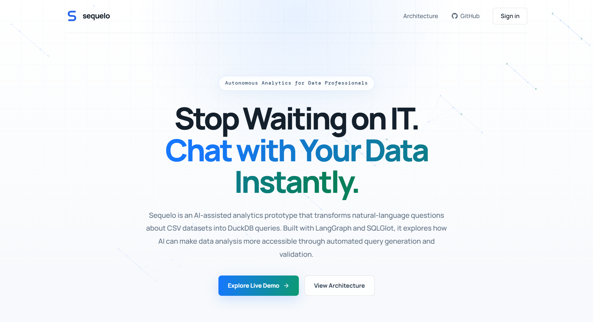
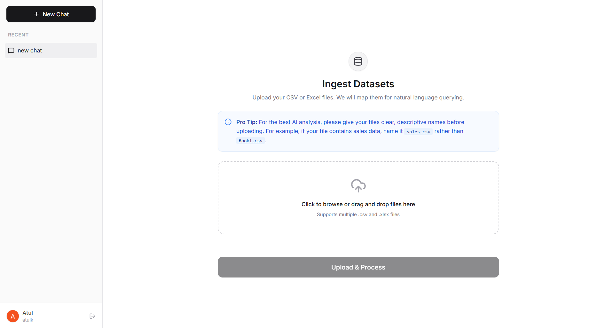
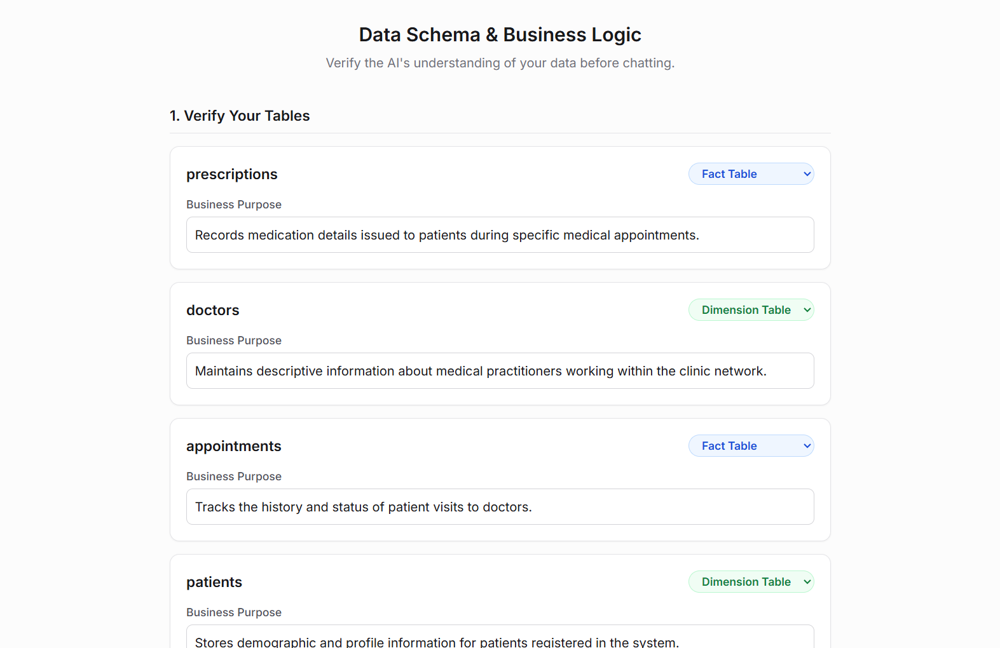
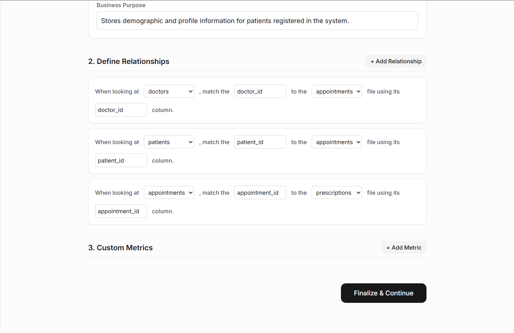
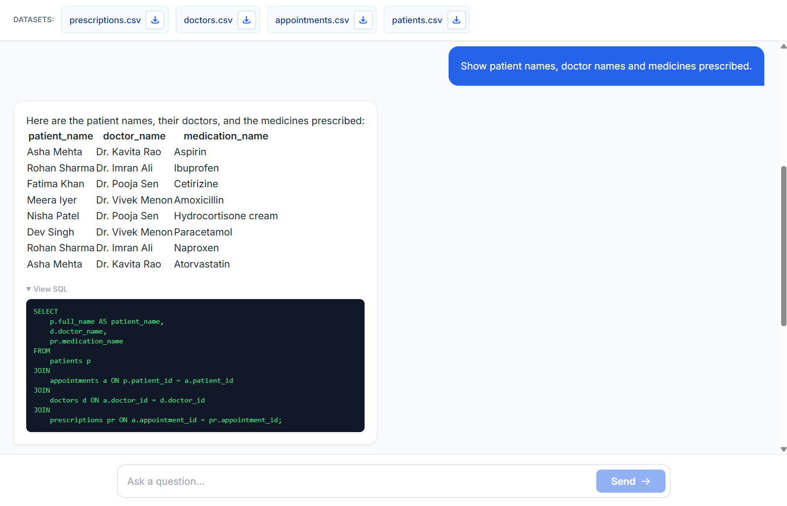
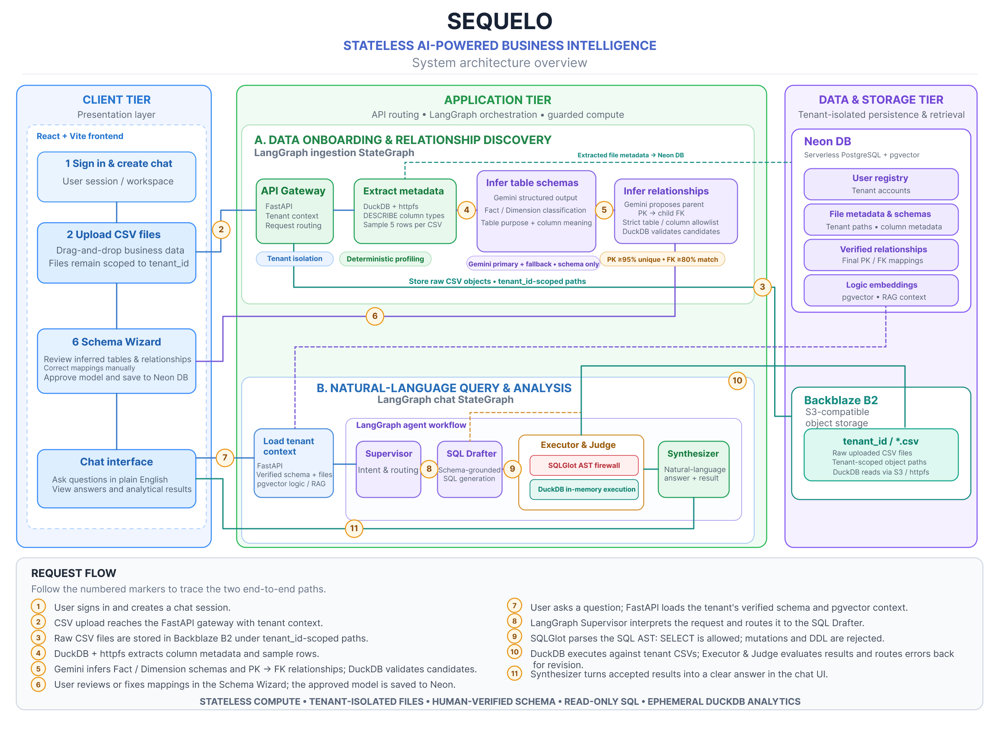

# Sequelo

**Chat with your CSV data. Get verified SQL answers, not guesses.**

A stateless, multi-tenant, AI-assisted BI platform: upload CSVs, verify the inferred schema, then ask questions in plain English. LangGraph agents write the SQL, an AST firewall validates it, and DuckDB does the math.

[**Live Demo**](https://sequelo.onrender.com) · [Architecture](#architecture) · [How It Works](#how-it-works) · [Engineering Highlights](#engineering-highlights)


> **Try it now:** open **[sequelo.onrender.com](https://sequelo.onrender.com)**, sign in with Google, upload a CSV and start asking questions. No setup needed.
> *(Hosted on Render's free tier, so the first request after idle time may take ~30-60 seconds to wake up.)*

---

## Screenshots

**Landing page**



**Upload your datasets**



**Schema Wizard: verify the inferred tables**



**Schema Wizard: define relationships**



**Chat: plain-English question, verified SQL answer**



---

## The Problem

Business users have questions, but answers sit behind an IT queue: security reviews, ETL pipelines, database access requests. A simple "which region had the highest repeat-purchase rate last quarter?" can take weeks.

Existing "chat with your data" tools hit a different wall: **LLMs are unreliable at arithmetic and can hallucinate or run unsafe queries.** You can't trust a number you can't verify, and you can't hand a model unrestricted database access.

## The Solution

Sequelo keeps the LLM where it is strong (understanding intent and writing SQL) and moves everything else to deterministic components:

| Concern | How Sequelo handles it |
|---|---|
| **Wrong numbers** | The LLM writes SQL only. **DuckDB computes every result.** |
| **Unsafe queries** | **SQLGlot parses the AST** before execution; non-`SELECT` statements are rejected. |
| **Hallucinated schemas** | Gemini *proposes* tables and relationships; **DuckDB validates them against real data** (PK uniqueness, FK match rate) and a **human approves** them in a Schema Wizard. |
| **Prompt injection** | Regex pre-filter, input wrapping/sanitization, and a supervisor agent with schema-level output validation. |
| **Data isolation** | Files stored under `tenant_id`-scoped paths; sessions are server-side. |
| **Infrastructure burden** | No database to connect. Analytics run on **ephemeral in-memory DuckDB** reading CSVs straight from object storage. |

---

## Features

- **Natural-language to SQL** over uploaded CSV files, with multi-turn follow-ups.
- **Automatic schema discovery**: Fact/Dimension classification, column descriptions, and PK to FK relationship inference.
- **Human-in-the-loop Schema Wizard** to review, correct and approve the model before chat begins.
- **Self-correcting query loop**: an Executor and Judge feed execution errors back to the SQL Drafter for revision.
- **Business-rule extraction**: define a metric in conversation ("a VIP is a customer with 5+ purchases") and it is captured for later queries.
- **LLM resilience**: Gemini primary-to-fallback chain with fail-fast timeouts; separate Groq-hosted models per agent role.
- **Secure Google sign-in** (OAuth 2.0 with PKCE, state and nonce) with Redis-backed sessions.
- **Single-container deployment**: FastAPI serves the compiled React app and the API together.

---

## Architecture



Sequelo is organised into three tiers and two LangGraph workflows.

**Client tier:** React + Vite SPA: sign-in, CSV upload, Schema Wizard, chat interface.

**Application tier:** FastAPI gateway plus two LangGraph `StateGraph`s:

- **A. Data Onboarding & Relationship Discovery**
  `Extract metadata → Infer table schemas → Infer relationships`
- **B. Natural-Language Query & Analysis**
  `Supervisor → SQL Drafter → Executor & Judge → Synthesizer`

**Data & storage tier:**

- **Neon DB** (serverless Postgres + pgvector): users, file metadata and schemas, verified relationships, logic embeddings.
- **Backblaze B2** (S3-compatible): raw CSVs under tenant-scoped paths, read directly by DuckDB via `httpfs`.
- **Redis**: server-side session and OAuth-state storage.

---

## How It Works

### 1. Onboarding: from raw CSVs to a verified semantic model

1. **Upload**: CSVs are stored in B2 under `tenant_id`-scoped paths.
2. **Profile**: DuckDB + `httpfs` runs `DESCRIBE` and samples 5 rows per file, with no LLM involved.
3. **Infer tables**: Gemini (structured output) classifies each table as Fact or Dimension and describes every column.
4. **Infer relationships**: Gemini proposes PK to FK pairs under a strict table/column allowlist. Each candidate is then **validated by DuckDB**:
   - PK candidate must be **≥ 95% unique**
   - FK values must **match ≥ 80%** of the parent keys
   - Failures are fed back to the model for up to 3 retries.
5. **Human review**: the user corrects mappings in the Schema Wizard; the approved model is saved to Neon.

### 2. Querying: from a question to a trustworthy answer

1. **Load tenant context**: verified schema, business rules, and pgvector retrieval.
2. **Supervisor**: classifies the request (`allow` / `direct_reply` / `reject`) and extracts any business rule the user defines.
3. **SQL Drafter**: generates DuckDB SQL grounded in the verified schema.
4. **Executor & Judge**: SQLGlot validates the AST (`SELECT` only), DuckDB executes against tenant CSVs, and the Judge routes errors back to the Drafter for revision (bounded loop).
5. **Synthesizer**: turns the result set into a clear answer, with Markdown tables for tabular output.

---

## Engineering Highlights

- **Deterministic core, probabilistic edges.** The LLM never computes numbers. Validation and execution are done by SQLGlot and DuckDB.
- **LLM output is treated as untrusted.** Proposed relationships are verified against real data statistics before a human ever sees them.
- **Defense in depth for SQL.** Input regex guardrails, untrusted-input wrapping, structured supervisor output with a security validator, then AST allow-listing, then an ephemeral in-memory engine.
- **Production-grade auth.** Authorization Code flow with **PKCE (S256), `state` and `nonce`**, ID-token verification against Google's JWKS, verified-email enforcement, replay-safe one-time OAuth state, and `HttpOnly` session cookies backed by Redis.
- **Stateless compute.** No persistent analytical database; each query spins up in-memory DuckDB over object storage.
- **Resilient LLM layer.** Fail-fast Gemini primary to fallback chain, and independently configurable Groq models/keys per agent role (supervisor, drafter, judge, synthesizer).
- **Async throughout.** `asyncpg` connection pooling, async Redis, and blocking DuckDB work offloaded with `asyncio.to_thread`.
- **Single-server deployment.** One Docker image serves the API and the built SPA, with a catch-all route that never shadows `/api/*`.

---

## Tech Stack

| Layer | Technology |
|---|---|
| **Frontend** | React, Vite |
| **Backend** | Python, FastAPI, Uvicorn |
| **AI orchestration** | LangGraph, LangChain, Gemini (`langchain-google-genai`), Groq (`langchain-groq`) |
| **Analytics engine** | DuckDB (+ `httpfs`), pandas |
| **SQL safety** | SQLGlot (AST validation) |
| **Database** | Neon serverless PostgreSQL, `asyncpg`, `pgvector` (RAG) |
| **Object storage** | Backblaze B2 (S3-compatible) |
| **Sessions / OAuth state** | Redis |
| **Auth** | Google OAuth 2.0 + OIDC (PKCE), PyJWT |
| **Deployment** | Docker, Render |

---

## Project Structure

```
sequelo/
├── backend/src/
│   ├── main.py              # FastAPI app, routers, SPA serving
│   ├── database.py          # Neon (asyncpg) connection pool
│   ├── b2_client.py         # Backblaze B2 client
│   ├── auth/                # Google OAuth (PKCE) + Redis sessions
│   ├── file_upload/         # CSV upload → tenant-scoped storage
│   ├── analyzing_agent/     # LangGraph ingestion pipeline + schema API
│   └── chat/                # LangGraph chat agent (Supervisor → Drafter → Judge → Synthesizer)
├── frontend/                # React + Vite SPA
├── docs/                    # Screenshots and architecture diagram
├── Dockerfile               # Single-image build
├── start.sh                 # Container entrypoint
├── init_db.py               # Database bootstrap
└── requirements.txt
```

---

## Configuration Reference

The app is configured entirely through environment variables. This reference documents the expected shape of the `.env` file; **no real values are committed.** It is provided for transparency into how the system is wired, not as a setup guide.

```env
# ── Database (Neon Postgres + pgvector) ─────────────────────────
NEON_DATABASE_URL=postgresql://<user>:<password>@<host>/<db>?sslmode=require

# ── Google OAuth 2.0 ────────────────────────────────────────────
GOOGLE_CLIENT_ID=<google-oauth-client-id>
GOOGLE_CLIENT_SECRET=<google-oauth-client-secret>
GOOGLE_REDIRECT_URI=https://<your-domain>/api/auth/google/callback
FRONTEND_URL=https://<your-domain>

# ── Sessions (Redis) ────────────────────────────────────────────
REDIS_HOST=<host>
REDIS_PORT=6379
REDIS_PASSWORD=<password>
SESSION_TTL_SECONDS=86400
COOKIE_SECURE=true

# ── Object storage (Backblaze B2, S3-compatible) ────────────────
B2_KEY_ID=<b2-key-id>
B2_APPLICATION_KEY=<b2-application-key>
B2_BUCKET_NAME=<bucket-name>
# Used by DuckDB httpfs to read CSVs directly from B2
AWS_ENDPOINT_URL_S3=https://s3.<region>.backblazeb2.com
AWS_ACCESS_KEY_ID=<b2-key-id>
AWS_SECRET_ACCESS_KEY=<b2-application-key>

# ── LLMs: ingestion pipeline (Gemini) ───────────────────────────
GEMINI_API_KEY=<gemini-api-key>
GEMINI_MODEL_NAME=<primary-gemini-model>

# ── LLMs: chat agents (Groq), configurable per role ─────────────
GROQ_API_KEY_SUPERVISOR=<groq-key>
GROQ_API_KEY_DRAFTER=<groq-key>
GROQ_API_KEY_JUDGE=<groq-key>
GROQ_MODEL_SUPERVISOR=<model>
GROQ_MODEL_DRAFTER=<model>
GROQ_MODEL_JUDGE=<model>
GROQ_MODEL_SYNTHESIZER=<model>
```

| Group | Purpose |
|---|---|
| `NEON_DATABASE_URL` | Users, file metadata, verified schemas/relationships, embeddings |
| `GOOGLE_*`, `FRONTEND_URL` | OAuth client and post-login redirect |
| `REDIS_*`, `SESSION_TTL_SECONDS`, `COOKIE_SECURE` | Session store and cookie policy |
| `B2_*`, `AWS_*` | Raw CSV storage and DuckDB `httpfs` access |
| `GEMINI_*` | Schema and relationship inference |
| `GROQ_*` | Supervisor, SQL drafter, judge and synthesizer models |

---

## Scope and Roadmap

Sequelo is a **portfolio prototype** built to explore reliable, safe LLM-driven analytics. Current scope and planned improvements:

- [ ] Stricter SQL allow-listing (restrict table functions and file-reading functions in generated queries)
- [ ] Automated evaluation set for text-to-SQL accuracy
- [ ] Support for additional formats (Parquet, Excel)
- [ ] Result visualisation (charts) in the chat UI
- [ ] CI pipeline with unit tests for guardrails and relationship validation
- [ ] Streaming responses

---

## Author

**Atul Kaushik**

[GitHub](https://github.com/atulkaushik156) · [LinkedIn](https://www.linkedin.com/in/atul-kaushik-2a2605381/) · [Email](mailto:atulkaushik156@gmail.com) · [Live Demo](https://sequelo.onrender.com)

*Open to AI / backend engineering roles. Feel free to reach out.*